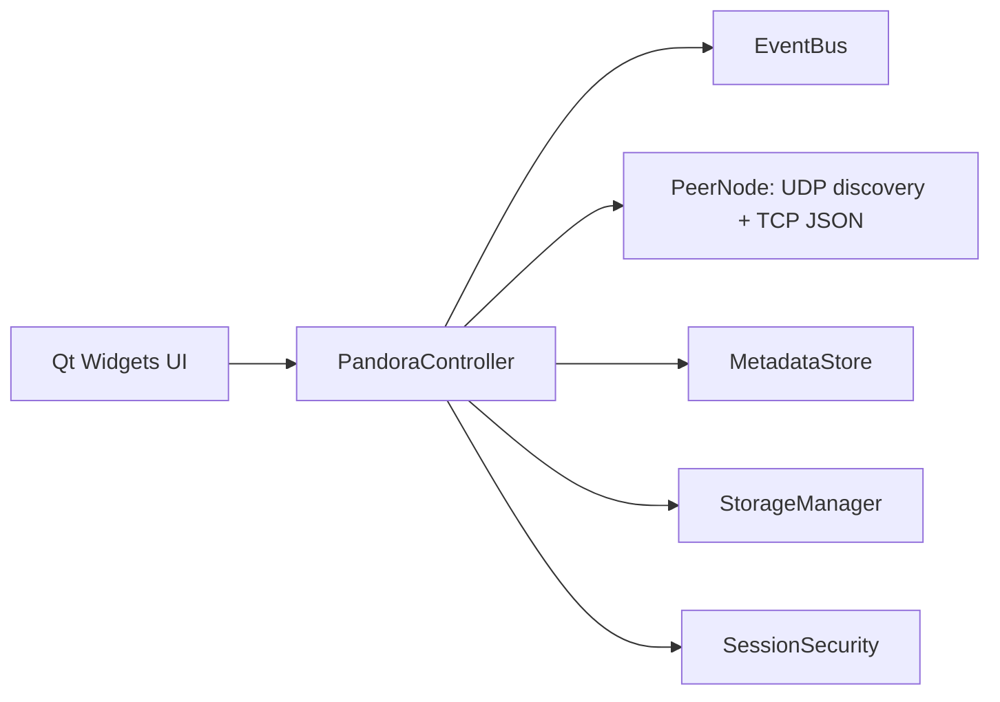
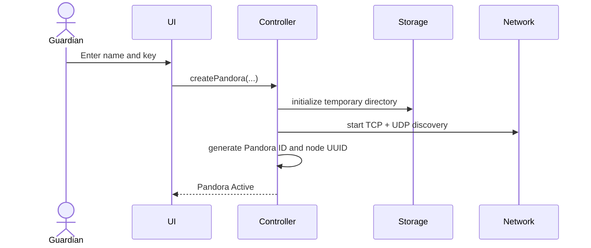

# Pandora

Pandora is a C++20 / Qt 6 desktop prototype for a temporary, LAN-based peer-to-peer storage cloud.

## Important implementation status

This repository is a **starter prototype**, not yet a complete secure distributed storage system. It builds the modular desktop foundation and implements a subset of the local-session workflow. It does **not** yet satisfy all requirements in the master specification.

Implemented:
- C++20 + Qt 6 + CMake project structure.
- Dark Qt Widgets dashboard.
- Session creation with generated Pandora ID.
- Temporary per-session storage directory.
- Streaming file copy in 1 MiB chunks.
- Local file metadata and duplicate-name check.
- Metadata JSON representation and snapshot merge.
- UDP LAN discovery and newline-delimited JSON over TCP.
- Event bus and initial event propagation scaffolding.
- Guardian identity in session metadata.
- Local download/export and session teardown.

Not yet implemented / not safe to claim complete:
- Join authentication handshake; join is deliberately rejected.
- End-to-end encrypted transport and a production-grade password/key KDF.
- Complete outbound peer mesh, event acknowledgements, retries, ordering, deduplication, and anti-entropy.
- Actual replica transfer, replica placement across peers, automatic self-healing.
- Distributed consensus / robust Guardian election.
- Folder upload UI and safe recursive folder transfer.
- Distributed file download from remote replicas.
- Correct distributed delete tombstones/garbage collection.
- Two-minute shutdown countdown and all-peer download-all workflow.
- Complete logs lifecycle and automated tests.
- Conflict-safe metadata convergence under partitions.
- Firewall and network-interface hardening.

Do not use this prototype to store sensitive or important data. The current key verifier uses salted SHA-256 for demonstration only, and the transport is not encrypted. A secure implementation should use a reviewed KDF (Argon2id/scrypt), a challenge-response protocol, authenticated encryption (e.g. TLS with pinned ephemeral session identities), and explicit protocol limits.

## Requirements

- CMake 3.21+
- A C++20 compiler
- Qt 6.4+ modules: Widgets, Network, Sql, Concurrent

`Qt6::Sql` and `Qt6::Concurrent` are linked for the planned SQLite and background-task layers; this starter does not yet persist metadata in SQLite.

## Build

```bash
cmake -S . -B build -DCMAKE_BUILD_TYPE=Release
cmake --build build --parallel
```

Run:

```bash
./build/Pandora
```

### Windows (Visual Studio 2022 + Qt 6 MSVC kit)

1. Install **Visual Studio 2022** with the **Desktop development with C++** workload.
2. Install CMake and a matching **Qt 6 MSVC 2022 64-bit** kit, including Widgets, Network, Sql, and Concurrent.
3. Open PowerShell in the extracted `Pandora` folder.
4. If Qt is installed somewhere non-standard, set the kit path first:

   ```powershell
   $env:QT_DIR = "C:\Qt\6.8.3\msvc2022_64"
   ```

5. Build:

   ```powershell
   .\build_windows.ps1
   ```

6. To launch the executable from PowerShell:

   ```powershell
   .\run_windows.ps1
   ```

The helper builds with the Visual Studio 2022 x64 generator. The compiler and Qt kit must match (MSVC, not MinGW). If Windows cannot locate Qt DLLs at launch, deploy them next to the executable using Qt's `windeployqt` tool from the same kit, for example:

```powershell
& "$env:QT_DIR\bin\windeployqt.exe" ".\build\Release\Pandora.exe"
```

## First run

1. Enter a Pandora name.
2. Enter a display name.
3. Enter a Pandora Key of at least six characters.
4. Select **Create Pandora**.
5. Upload a file; it is stored only in the local node's temporary replica directory.
6. Download exports a locally stored file to a destination path.
7. Deactivate removes the local temporary replica directory and clears local metadata.

## Architecture



Module boundaries:
- `ui`: user interaction only.
- `core`: orchestration and shared data types/events.
- `network`: discovery and transport framing.
- `metadata`: in-memory replicated metadata model.
- `storage`: temporary replica file I/O.
- `security`: session key helpers.

## Event envelope

```json
{
  "eventId": "UUID",
  "type": "FileAdded",
  "originNodeId": "UUID",
  "timestamp": "UTC ISO-8601",
  "payload": {}
}
```

## Initial sequence: create



## Planned next implementation milestones

1. Define versioned wire protocol, limits, session challenge-response, and TLS identity.
2. Implement bidirectional peer connections and peer registry.
3. Add membership leases, disconnect detection, and event IDs/deduplication.
4. Add replica transfer with chunked streams, checksums, and acknowledgements.
5. Add deterministic replica selection and repair queue.
6. Add replicated tombstones and version-vector or consensus-backed conflict semantics.
7. Add a real shutdown protocol with a two-minute timer and user exports.
8. Add tests for serialization, storage, security, convergence, and fault injection.

## Portable Windows package (no Qt installation on target PCs)

A ready-to-run Windows executable must be compiled on a Windows/MSVC build host and bundled with Qt runtime libraries. This repository includes a GitHub Actions workflow at `.github/workflows/windows-portable.yml` that builds the project on Windows and uploads a `Pandora-Portable-Windows-x64.zip` artifact. The target PC does not need Qt, Visual Studio, CMake, or a compiler.

To obtain the artifact:
1. Create a GitHub repository and upload the contents of this project folder.
2. Open the repository's **Actions** tab.
3. Select **Build portable Pandora for Windows** and choose **Run workflow** (or push to `main`/`master`).
4. When the workflow finishes, open its run and download the `Pandora-Portable-Windows-x64` artifact.
5. Extract the ZIP and double-click `Pandora.exe`.

If you already have the required Qt MSVC kit and have built Pandora locally, run `package_windows.ps1` to assemble a portable ZIP.

**Limitations:** This environment cannot produce or verify a Windows executable because it does not contain the Windows MSVC toolchain and Qt 6. The workflow is included to perform the Windows build on GitHub-hosted Windows runners. The application itself remains an educational prototype: cross-node replication, authenticated/encrypted peer joining, remote retrieval, and complete self-healing are not yet implemented. Do not use it for sensitive data.

## Windows x64 build and packaging scripts

For the Qt 6.12 MinGW setup used by the project author, see
`BUILD_WINDOWS_README.txt` and run `build_and_package_windows.bat`. This creates
`dist/Pandora-Portable-Windows-x64.zip` after compilation and Qt runtime
bundling. An optional Inno Setup definition is provided in
`Pandora_Setup.iss`.

These scripts package the existing proof of concept; they do not implement the
missing distributed-storage features listed above. Test the ZIP on a clean
Windows 11 x64 machine before distributing it.
