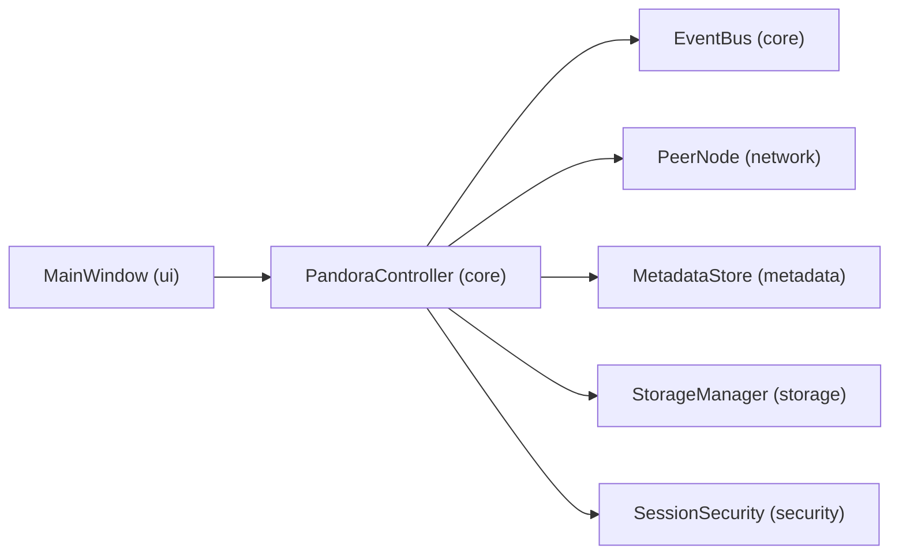
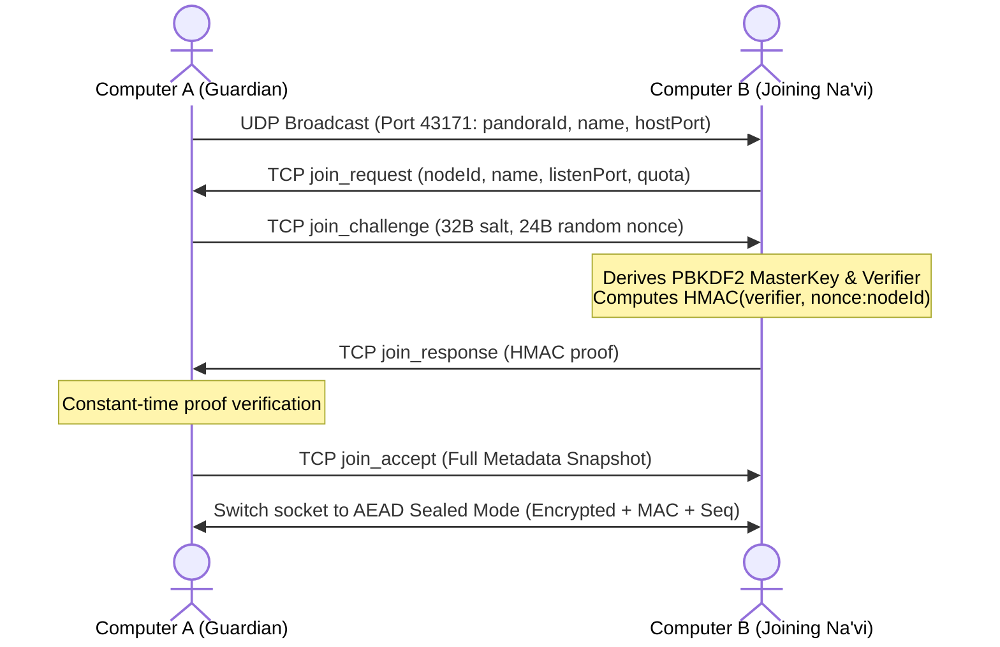

# Pandora — Ephemeral Decentralized Peer-to-Peer LAN Cloud Storage

**Pandora** is a C++20 and Qt 6 desktop application that creates a **session-based, encrypted, decentralized peer-to-peer (P2P) storage cloud** across a Local Area Network (LAN).

Unlike traditional cloud services that rely on centralized remote servers or permanent local folders, Pandora pools temporary storage across connected computers (**"Na'vi"**) under the coordination of a session leader (**"Guardian"**). Files and folders uploaded to Pandora are automatically chunked, checksum-verified, and replicated across multiple peers. If any computer—including the original uploader or Guardian—disconnects, the surviving nodes automatically elect a new Guardian and self-heal missing file replicas. When the Pandora session is deactivated, all temporary replicas across every device are securely wiped from disk.

---

## Table of Contents

1. [Key Features](#key-features)
2. [How Pandora Works (Conceptual Explanation)](#how-pandora-works-conceptual-explanation)
3. [Tech Stack](#tech-stack)
4. [System Architecture & Module Structure](#system-architecture--module-structure)
5. [End-to-End Workflows](#end-to-end-workflows)
6. [Security & Cryptographic Design](#security--cryptographic-design)
7. [Network Ports & Firewall Requirements](#network-ports--firewall-requirements)
8. [Getting Started: Build, Run & Package](#getting-started-build-run--package)
9. [Running Multi-Node Sessions](#running-multi-node-sessions)
10. [Automated Testing Suite](#automated-testing-suite)
11. [Troubleshooting](#troubleshooting)

---

## Key Features

- **Zero-Server LAN Discovery**: Automatically discovers active Pandora sessions on the local network via multi-interface IPv4 UDP broadcast (`43171`) with fallback support for direct IP:Port connections.
- **Authenticated Peer Joining**: Uses a 60,000-round **PBKDF2-HMAC-SHA256** key derivation and a cryptographic **challenge-response handshake** so unauthorized peers on the same Wi-Fi/LAN cannot join or snoop.
- **Encrypted Peer Mesh Transport (AEAD)**: All post-handshake peer traffic is sealed in authenticated encryption frames (HMAC-SHA256 counter-mode keystream + Encrypt-then-MAC authentication tags + monotonic sequence numbers for replay protection).
- **Automatic Multi-Node File & Folder Replication**: Uploads are written atomically (`.part` -> `.blob`) and streamed in 256 KiB chunks to peers with the lowest storage usage and sufficient disk/quota capacity.
- **End-to-End SHA-256 Integrity Verification**: Every file and replica is verified against its SHA-256 digest before metadata commits or exports occur.
- **Remote File Retrieval & Replica Fallback**: Any peer can download any file in the cloud even if the original uploader goes offline; if a replica peer disconnects mid-download, Pandora automatically fails over to another online replica.
- **Automatic Self-Healing**: Continuously audits replica counts and checksums, automatically re-replicating under-replicated files to healthy peers when a device leaves the network.
- **Deterministic Guardian Failover**: If the current Guardian disconnects unexpectedly, surviving peers deterministically elect a new Guardian using join-order timestamps, UUID tie-breaking, and monotonically increasing election terms.
- **Coordinated 2-Minute Shutdown & "Download All"**: Guardians can trigger a 120-second session-wide shutdown countdown, alerting all peers with a live banner so users can export files via **Download All** before session deactivation.
- **Ephemeral Storage & Crash Orphan Cleanup**: Stores encrypted/chunked blobs in per-session temporary directories (`<Temp>/pandora-<UUID>`) protected by `.session.pid` lockfiles, performing zero-fill erasure upon deletion/deactivation and cleaning up orphaned crash folders on startup.

---

## How Pandora Works (Conceptual Explanation)

Pandora uses terminology inspired by *Avatar*:
- **Pandora**: The temporary shared P2P storage session.
- **Na'vi**: Each computer/node participating in the session.
- **Guardian**: The coordinator node responsible for authorizing session-wide shutdowns. If the Guardian leaves, the network elects a new Guardian automatically.

```
   +----------------------+
   |      Computer A      |  1. Creates "EywaCloud" (Guardian)
   |   (Guardian Node)    |  2. Uploads report.pdf (512 KiB)
   +----------+-----------+
              |
     +--------+--------+     3. Automatic Chunked Replication (256 KiB chunks)
     |                 |        + End-to-End SHA-256 Verification
     v                 v
+---------+       +---------+
| Peer B  | <---> | Peer C  |  4. Full Bidirectional Encrypted Mesh
| Replica |       | Replica |  5. If A disconnects -> B becomes Guardian
+---------+       +---------+     and B & C maintain/repair replicas
```

---

## Tech Stack

| Layer | Technology / Standard | Purpose |
| :--- | :--- | :--- |
| **Language** | **C++20** (`std::atomic`, RAII, lambdas) | High-performance native systems programming |
| **UI Framework** | **Qt 6 Widgets** (`QMainWindow`, `QTableWidget`, `QTabWidget`) | Dark-themed desktop dashboard, tables, and live progress indicators |
| **Networking** | **Qt 6 Network** (`QTcpServer`, `QTcpSocket`, `QUdpSocket`, `QNetworkInterface`) | Multi-interface UDP LAN discovery and persistent bidirectional TCP peer mesh |
| **Persistence** | **Qt 6 SQL / SQLite 3** (`QSqlDatabase`, WAL mode) | Per-session relational persistence for nodes, file catalog, and deduplicated event logs |
| **Cryptography** | **Qt Cryptographic Hash & MAC** (`QCryptographicHash`, `QMessageAuthenticationCode`, `QRandomGenerator::system()`) | PBKDF2-HMAC-SHA256 (60k rounds), SHA-256 file hashing, Challenge-Response, and AEAD transport sealing |
| **Build System** | **CMake 3.21+** | Cross-compiler build configuration (MinGW-w64 GCC & MSVC 2022) |
| **Testing** | **Qt 6 Test** (`QTest`, `QSignalSpy`, CTest) | Unit tests and automated 3-node loopback integration tests |
| **Packaging** | **PowerShell + `windeployqt` + Inno Setup 6 + GitHub Actions** | Standalone portable Windows `.zip` bundle and `.exe` installer |

---

## System Architecture & Module Structure



```text
Pandora/
├── CMakeLists.txt                      # CMake build definition (PandoraCore, Pandora, PandoraTests)
├── include/
│   ├── core/
│   │   ├── types.h                     # Domain models (NodeInfo, FileInfo, PandoraSession, PandoraEvent)
│   │   ├── event_bus.h                 # In-process Qt signal event dispatcher
│   │   └── pandora_controller.h        # Distributed storage & session orchestrator
│   ├── metadata/
│   │   └── metadata_store.h            # Thread-safe in-memory + SQLite WAL metadata store
│   ├── network/
│   │   └── peer_node.h                 # UDP broadcast discovery + AEAD-sealed TCP mesh
│   ├── security/
│   │   └── session_security.h          # PBKDF2-HMAC-SHA256, Challenge-Response, AEAD cipher
│   ├── storage/
│   │   └── storage_manager.h           # Atomic staging (.part -> .blob), quotas, orphan cleanup
│   └── ui/
│       └── main_window.h               # Qt6 desktop GUI dashboard
├── src/                                # Corresponding C++20 implementations
├── tests/
│   └── pandora_distributed_tests.cpp   # Automated unit & 3-node integration test suite
├── docs/
│   ├── architecture.md                 # Detailed architectural notes
│   └── protocol.md                     # Wire protocol & cryptographic frame specification
├── build_windows_mingw.ps1             # MinGW-w64 build script
├── package_windows_mingw.ps1           # Portable Windows ZIP packager (windeployqt)
├── build_and_package_windows.bat       # One-click build & package launcher
└── Pandora_Setup.iss                   # Inno Setup 6 Windows installer script
```

---

## End-to-End Workflows

### 1. Session Creation & Authenticated Join


### 2. File Upload & Distributed Replication
1. User selects a file (or folder) in `MainWindow`.
2. `StorageManager::storeFile` streams the file in 1 MiB chunks into `<Temp>/pandora-<UUID>/<fileId>.part`, computing its SHA-256 digest in a single pass, then atomically renames it to `<fileId>.blob`.
3. `MetadataStore::addFile` records the `FileInfo` with version vector `v1` and broadcasts `FileAdded` to all peers.
4. `PandoraController::chooseReplicas` selects online peers sorted by lowest `managedBytes` that have available quota and disk space.
5. `PandoraController::pushReplicaToNode` streams the file in 256 KiB chunks (`replica_push_begin` -> `replica_push_chunk` -> `replica_push_end`).
6. Receiving peers verify the full SHA-256 hash in `finalizeChunkedWrite`, commit `.part` to `.blob`, reply with `replica_commit_ack`, and broadcast `ReplicaChanged`.

### 3. Peer Failure, Guardian Election & Self-Healing
1. `PeerNode` exchanges `ping`/`pong` heartbeats every 3 seconds.
2. When a peer disconnects or times out (>12s), `onPeerDisconnected` marks the node offline and strips its ID from file replica lists.
3. If the disconnected node was the **Guardian**, `MetadataStore::electDeterministicGuardian()` selects the longest-running connected peer (with lexicographical UUID tie-breaking), increments the election `term`, and broadcasts `GuardianChanged`.
4. `triggerReplicaAuditAndRepair()` identifies any file whose online replica count dropped below `replicationFactor` and pushes new verified replicas from the primary surviving holder to healthy peers.

---

## Security & Cryptographic Design

- **Key Derivation**: Passkeys (6+ characters) are stretched using **60,000 iterations of PBKDF2-HMAC-SHA256** with a 256-bit random salt (`QRandomGenerator::system()`).
- **Domain Separation**: Separate subkeys are derived via HMAC-SHA256 for authentication verification (`pandora-auth-verifier-v1`), transport sealing (`pandora-transport-key-v1:<pandoraId>`), encryption (`pandora-enc-subkey`), and message authentication (`pandora-mac-subkey`).
- **Replay & Tamper Protection**: Every encrypted frame carries a 24-byte random nonce, a monotonically increasing 64-bit sequence number (`seq`), and a 32-byte HMAC-SHA256 tag verified in constant time.
- **Path Traversal Sanitization**: `StorageManager::sanitizeRelativePath` strips `..`, drive letters, and invalid characters from all local and remote file/folder names.
- **Secure Ephemeral Erasure**: Deleted files and deactivated session blobs are zero-filled before unlinking (`secureEraseFile`).

---

## Network Ports & Firewall Requirements

| Protocol | Port | Direction | Usage |
| :--- | :--- | :--- | :--- |
| **UDP** | `43171` | Inbound / Outbound Broadcast | LAN Session Discovery (`255.255.255.255`, subnet broadcasts, and `127.0.0.1`) |
| **TCP** | `43170` *(default)* | Inbound / Outbound | Challenge-Response Auth, Encrypted Event Gossip, and Chunked File Replication |

> **Firewall Note**: On first launch, Windows Defender Firewall will prompt to allow `Pandora.exe`. Enable access on **Private networks** so peers on your Wi-Fi/LAN can discover and connect to each other.

---

## Getting Started: Build, Run & Package

### Prerequisites (For Building from Source)
- **Windows 10 / 11 (x64)**
- **CMake 3.21+**
- **Qt 6.4+** (`Widgets`, `Network`, `Sql`, `Concurrent`, `Test`)
- **Compiler**: MinGW-w64 GCC 13+ (or Visual Studio 2022 MSVC x64)

### 1. One-Command Build & Portable Packaging (MinGW)
Double-click `build_and_package_windows.bat` or run from PowerShell:
```powershell
# Compile Pandora.exe and PandoraTests.exe into build-mingw\
powershell -NoProfile -ExecutionPolicy Bypass -File .\build_windows_mingw.ps1

# Bundle Qt6 + SQLite + MinGW DLLs into dist\Pandora-Portable\ and create ZIP
powershell -NoProfile -ExecutionPolicy Bypass -File .\package_windows_mingw.ps1
```
This produces:
- **Standalone Folder**: `dist\Pandora-Portable\Pandora.exe`
- **Distributable Archive**: `dist\Pandora-Portable-Windows-x64.zip` *(can be extracted and run on any Windows PC without Qt installed)*

### 2. Build with Visual Studio 2022 (MSVC)
```powershell
.\build_windows.ps1
.\package_windows.ps1
```

---

## Running Multi-Node Sessions

### Scenario A: Across Multiple Computers on the Same Wi-Fi / LAN
1. Extract `dist\Pandora-Portable-Windows-x64.zip` on each computer and launch `Pandora.exe`.
2. On **Computer 1**, open the **Create Pandora** tab, enter a Pandora Name, your Na'vi Name, and a Pandora Key (6+ chars), and click **Create Pandora Session**.
3. On **Computer 2 & 3**, open the **Join Pandora (LAN)** tab, click the discovered session in the list, enter your Na'vi Name and the same Pandora Key, and click **Authenticate & Join Pandora**.

### Scenario B: Simulating 3 Nodes on a Single Computer
You can test the entire distributed system on a single machine by launching three instances:
```powershell
Start-Process .\dist\Pandora-Portable\Pandora.exe
Start-Process .\dist\Pandora-Portable\Pandora.exe
Start-Process .\dist\Pandora-Portable\Pandora.exe
```
- Create a session in Window 1 (listens on TCP `43170`).
- Join from Window 2 and Window 3 (Pandora automatically binds available ephemeral TCP ports when `43170` is already in use on localhost, or you can set a custom port in **Settings & Quotas**).

---

## Automated Testing Suite

Pandora includes an automated QtTest suite ([`tests/pandora_distributed_tests.cpp`](tests/pandora_distributed_tests.cpp)) that tests cryptography, atomic storage, SQLite metadata convergence, and a live 3-node cluster workflow:

```powershell
$env:Path = "C:\Qt\6.12.0\mingw_64\bin;C:\Qt\Tools\mingw1310_64\bin;$env:Path"
.\build-mingw\PandoraTests.exe
```

What `PandoraTests.exe` verifies:
1. **`testSecurityPbkdf2AndChallengeAndAead`**: Verifies 60k-round PBKDF2 key derivation, challenge-response proofs, AEAD encryption/decryption, and ciphertext tamper rejection.
2. **`testStorageAtomicWriteChunkingAndQuotas`**: Verifies single-pass atomic `.part` -> `.blob` writes, chunked network writes, SHA-256 mismatch rejection, and path traversal sanitization.
3. **`testMetadataConvergenceAndTombstoneProtection`**: Verifies SQLite WAL persistence, duplicate filename rejection, and tombstone protection against deleted-file resurrection.
4. **`testThreeNodeEndToEndReplicationRetrievalSelfHealingAndElection`**: Spins up 3 nodes (`NodeA`, `NodeB`, `NodeC`), rejects an invalid key, authenticates `B` and `C`, uploads a 512 KiB file on `A`, verifies physical replication, disconnects Guardian `A`, verifies deterministic Guardian election between `B` and `C`, verifies automatic self-healing replication, verifies remote download from `B` to `C` while uploader `A` is offline, and verifies distributed deletion across all nodes.
5. **`testFolderUploadDownloadAllAndGuardianShutdownCountdown`**: Verifies recursive folder uploads, cross-node replication, `Download All` batch export, and Guardian shutdown countdown completion.

---

## Troubleshooting

- **Session does not appear in "Discovered LAN Sessions"**:
  - Ensure all computers are on the same subnet/Wi-Fi and that Windows network profile is set to **Private** (or allow UDP `43171` and TCP `43170` in Windows Defender Firewall).
  - You can always bypass UDP broadcast restrictions by entering the host's LAN IP address and TCP port (`43170`) directly in the **Join Pandora (LAN)** tab.
- **Upload rejected with "Storage quota exceeded"**:
  - Increase the **Local Storage Quota Allocation (GiB)** in the **Settings & Quotas** tab and click **Apply Storage & Network Settings**.
