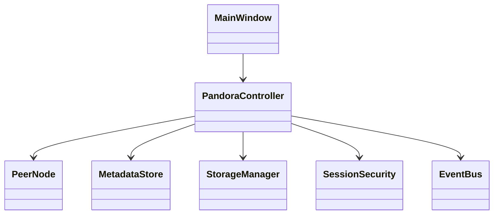

# Pandora architecture notes

## Class responsibilities

- `MainWindow`: Qt Widgets UI and input validation presentation.
- `PandoraController`: use-case orchestration; no UI widget access.
- `PeerNode`: UDP discovery, TCP socket lifecycle, newline-framed JSON.
- `MetadataStore`: thread-safe in-memory nodes/files/session metadata.
- `StorageManager`: streaming local replica storage in a temporary directory.
- `SessionSecurity`: key verifier/salt helper; demonstration only.
- `EventBus`: in-process event dispatch.

## Class diagram

## Key distributed-system design constraints

A real P2P system cannot assume a broadcast is delivered exactly once or that every node remains connected. Events must be versioned, bounded, authenticated, deduplicated, and replayable. A replicated metadata model needs an explicit convergence strategy. Last-write-wins timestamps alone are vulnerable to clock skew; UUID tie-breaking only resolves equal timestamps, not concurrent operations in a principled way.

Leader election should be treated as a coordination protocol, not simply random local selection: two partitions can elect different Guardians. If the project deliberately tolerates temporary split-brain, document the consistency trade-off and reconcile after merge. Otherwise, use a consensus protocol or a carefully scoped single-writer lease.

Replica repair must distinguish temporary disconnects from permanent departure. Replicas should be copied and checksum-verified before metadata claims the new replica exists. On shutdown, every node needs an authenticated, idempotent deactivation event and a local cleanup guarantee.
