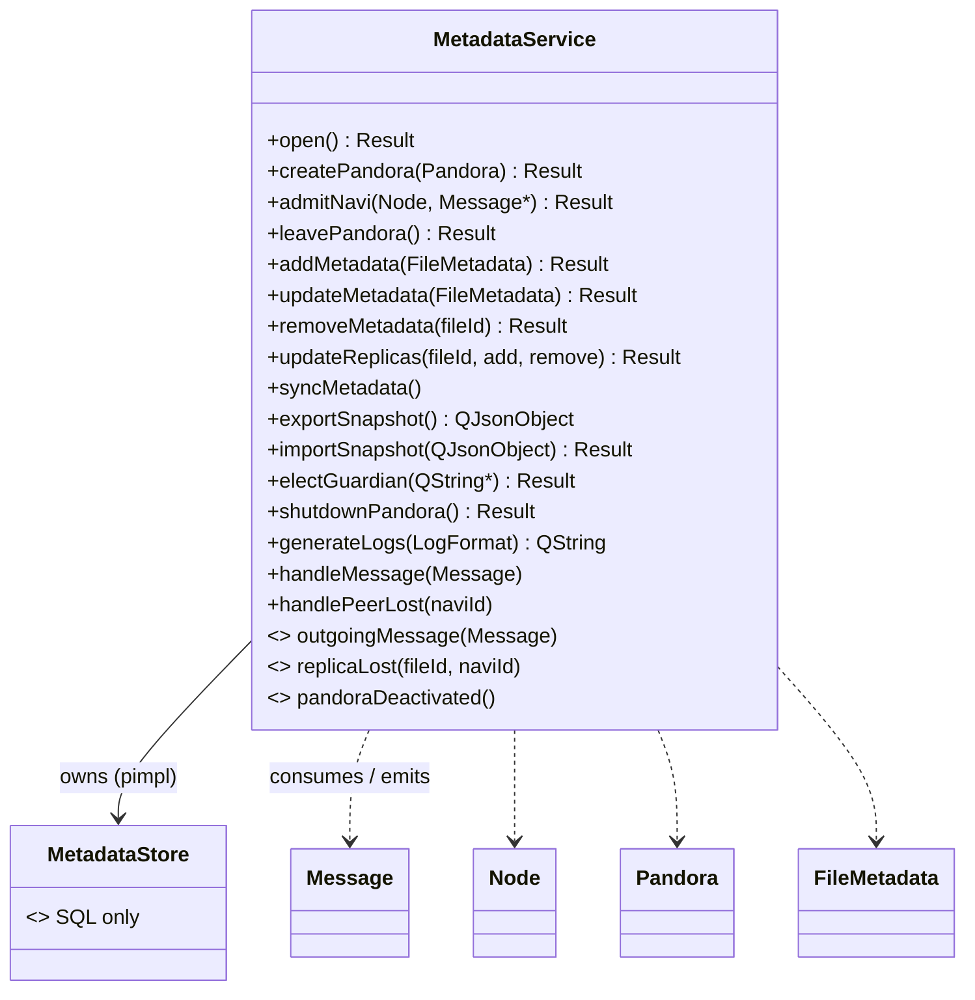
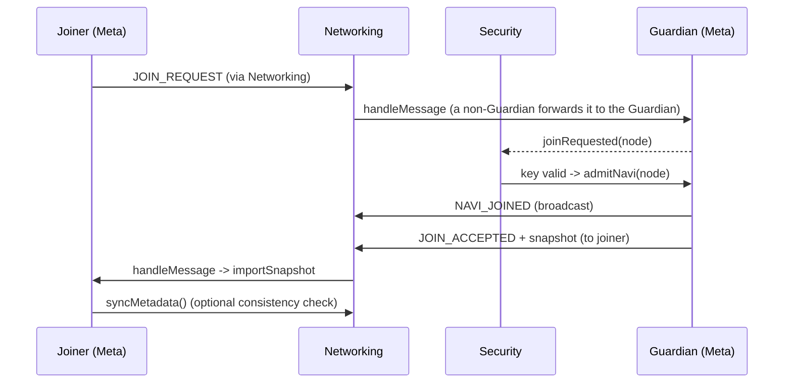

# Architecture - Metadata module

## Class diagram



Only `MetadataService.h` and `pandora/shared/*` are public. `MetadataStore` is invisible to other modules.

## Event handling

| Message | Effect on local metadata |
|---|---|
| CREATE_PANDORA | Ignored by metadata (discovery announcement; membership only via JOIN_ACCEPTED) |
| JOIN_REQUEST | Emit `joinRequested` (key check belongs to Security) |
| JOIN_ACCEPTED | Import snapshot (only while not yet in a Pandora) |
| NAVI_JOINED | Add Na'vi (never resurrects) |
| NAVI_LEFT / `handlePeerLost` | Mark disconnected, drop its replicas, emit `replicaLost` per file, elect Guardian if needed |
| FILE_UPLOAD / FILE_UPDATE | Last-Write-Wins merge, duplicate-name resolution, tombstones respected |
| FILE_DELETE | Delete + tombstone |
| METADATA_SYNC | `snapshot_request` -> reply with snapshot; `snapshot` -> merge (never touches replicas of an already-known write); `replica_update` -> add/remove replicas; `logs_request` (Guardian only) -> reply with own log; `logs` -> collected by the Guardian |
| GUARDIAN_CHANGED | Accept if sender is the named successor and epoch is newer |
| SHUTDOWN_WARNING | Accept only from the Guardian, start countdown |
| PANDORA_DEACTIVATE | Accept only from the Guardian, wipe |
| FILE_REQUEST / FILE_RESPONSE | Ignored (Storage's traffic) |

## Sequence: join



## Sequence: Guardian disappears

```mermaid
sequenceDiagram
    participant N1 as Na'vi B
    participant N2 as Na'vi C
    Note over N1,N2: Networking detects Guardian A lost on each node
    N1->>N1: handlePeerLost(A): hash(pandoraId, epoch+1, A) -> winner W
    N2->>N2: handlePeerLost(A): same computation -> same W
    Note over N1,N2: Only W broadcasts GUARDIAN_CHANGED(epoch+1); others ignore it as already applied
```

## Sequence: shutdown

```mermaid
sequenceDiagram
    participant G as Guardian
    participant M as Every other Na'vi
    G->>M: SHUTDOWN_WARNING (120 s)
    Note over G,M: each node starts its own timer; UI offers Download / Download All
    G->>M: PANDORA_DEACTIVATE (at 0, or each node's own timer fires)
    G->>G: finalLogsReady(logs)
    G->>G: wipe: close DB, erase file, emit pandoraDeactivated
    M->>M: wipe: close DB, erase file, emit pandoraDeactivated
```

## Thread safety

Public methods lock a recursive mutex. The SQLite connection is created and used in the thread that calls `open()`;
use the service from one thread (normally the GUI thread) or connect its signals/slots with queued connections.
