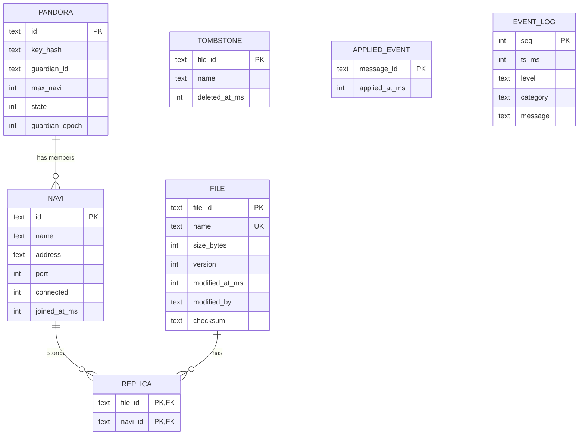

# Metadata database design

One SQLite database per node; every node holds all of it. Source of truth: [sql/schema.sql](../sql/schema.sql),
embedded into the library at build time. Default location is `:memory:`; a file path is erased (with `-wal`, `-shm`,
`-journal`) on deactivation.

| Table | Purpose |
|---|---|
| `pandora` | Single row: ID, **hash** of the key (never the raw key), Guardian, capacity, state (0 Active, 1 ShuttingDown), Guardian epoch |
| `navi` | Na'vi registry with `connected` flag (only ever 1 -> 0) |
| `file` | File metadata; `name` is UNIQUE (no duplicate names); `version` + `modified_at_ms` + `modified_by` implement Last Write Wins |
| `replica` | Replica locations; deleting a file cascades, deleting a Na'vi's replicas happens when it leaves |
| `tombstone` | Deleted file ids, so a late upload/edit cannot resurrect a file |
| `applied_event` | Message ids already applied (idempotency) |
| `event_log` | Audit log that the Guardian can view; returned as final logs on deactivation |
| `v_navi_usage` (view) | Bytes and file count per Na'vi, computed from `replica` JOIN `file`; basis for least-loaded replica selection |

Rules enforced in code: `connected` never goes back to 1; replicas pointing to unknown Na'vi are dropped; replicas of
disconnected Na'vi are removed (this is what triggers `replicaLost` for self-healing).
