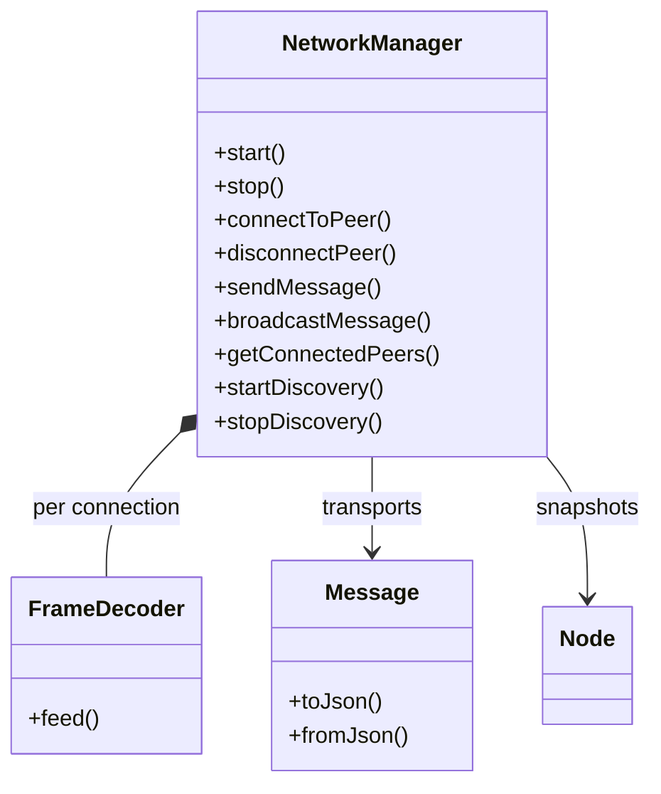
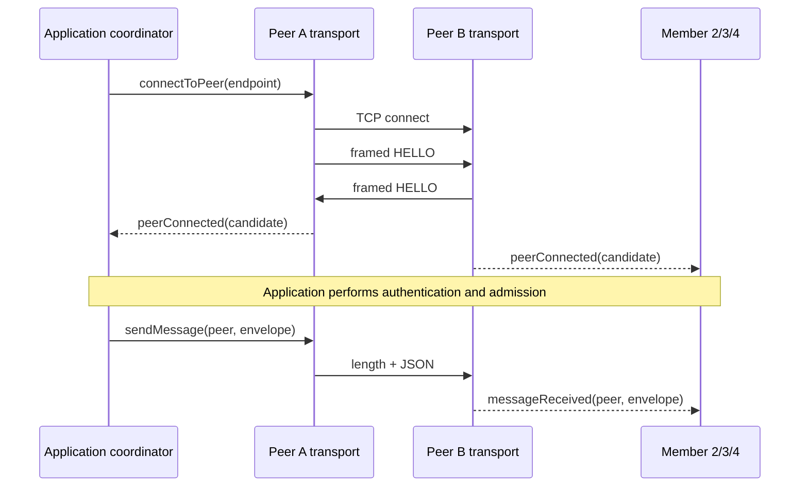
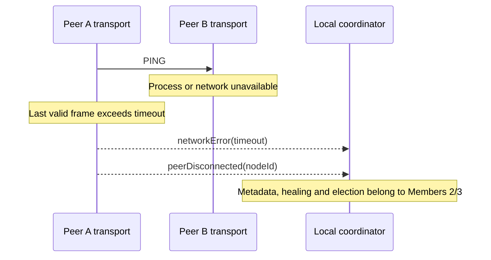

# Architecture and integration

All peers run the same NetworkManager. Each manager has a TCP listener and outgoing connections. A listener is a role of every peer, not a permanent server. UDP discovery provides endpoint hints; an external application coordinator builds the desired mesh.

NetworkManager owns TCP/UDP sockets and timers through Qt QObject lifetime management. Private per-stream state is held with unique_ptr. Protocol and model declarations have no dependency on UI, SQL, storage, or authentication implementations. Public APIs are in shared include headers; callers receive values and signals.

## Connect and message sequence

## Disconnect sequence

No NAVI_JOINED/NAVI_LEFT event is manufactured from socket state. The application coordinator determines membership and broadcasts those events after authentication. This separation prevents the transport from silently implementing metadata or lifecycle policy.

